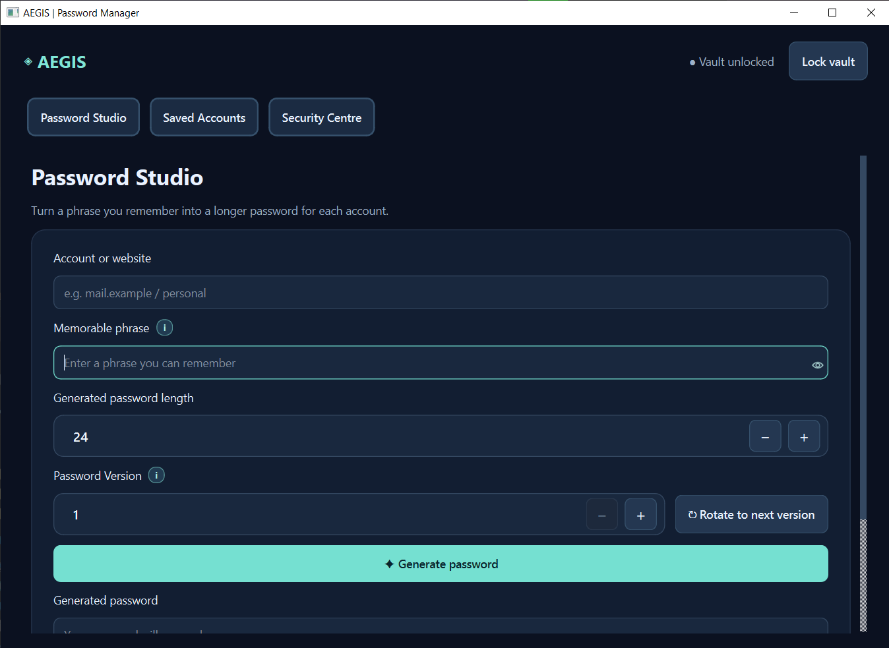
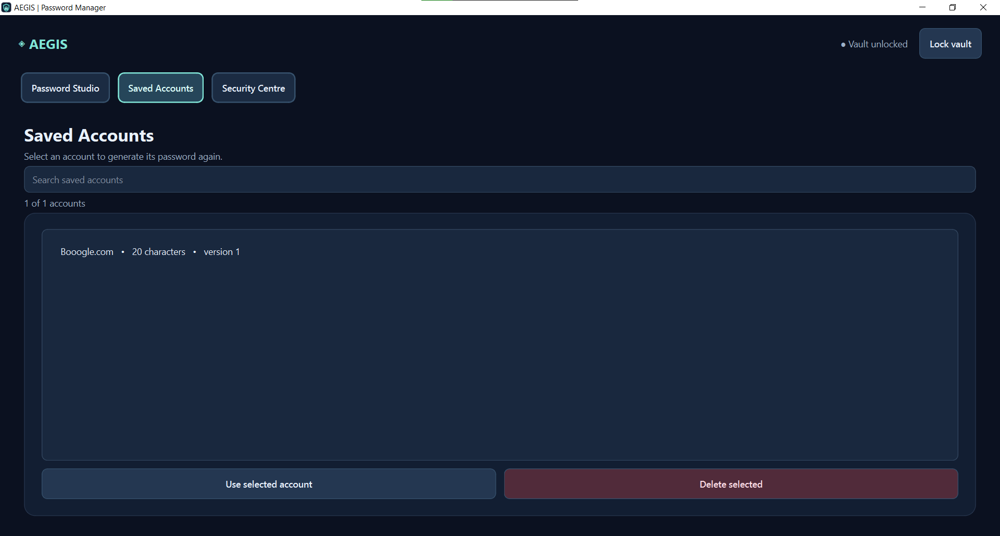
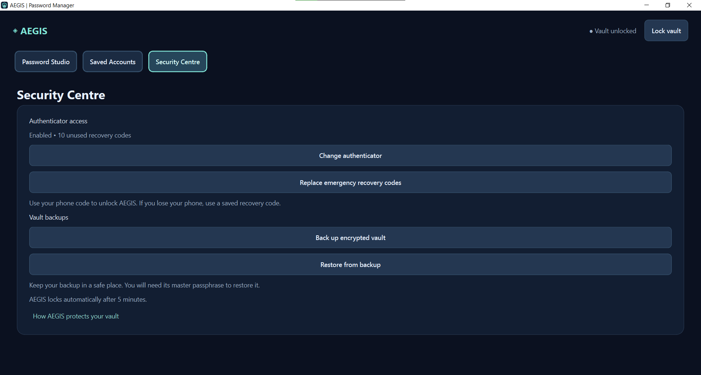

# AEGIS Password Studio

**A desktop password generator and offline browser edition, built with Python, PySide6, JavaScript, HTML and CSS.**

AEGIS turns a memorable phrase into a reproducible, account-specific password. Choose a website/account, a phrase, a password length and a version. The desktop edition adds a local encrypted vault for a private generation key and account settings. The Web Edition translates the core derivation algorithm into JavaScript and runs in a modern browser without an online account.



## Features

- **Deterministic, per-account passwords:** length from 12 to 128 characters, with version-based rotation.
- **Local encrypted desktop vault:** Argon2id key derivation and AES-256-GCM encryption.
- **Saved account settings:** search and reopen account name, length and version without saving the memorable phrase or generated password.
- **Optional authenticator:** TOTP login, single-use recovery codes and auto-lock.
- **Encrypted backups:** export, verify and restore, with a pre-restore safety copy.
- **Browser edition:** Web Crypto implementation of the same password-generation algorithm, with an ephemeral browser key.
- **Windows installation:** build an installer using PyInstaller and Inno Setup.

## See the interface

| Saved Accounts | Security Centre |
|:--:|:--:|
|  |  |

## Getting started

### Desktop application (Python)

**Requirements:** Python 3.11+, 64-bit Windows recommended for the tested installer workflow. The PySide6 source may run on other operating systems, but those builds have not been fully verified.

```powershell
cd desktop
python -m pip install -r requirements.txt
python run.py
```

On first run, create a master passphrase. Optional authenticator enrolment and backup management are available in Security Centre. AEGIS stores its vault in a per-user data directory rather than the source repository.

The source for the Windows setup installer is included under [`desktop/packaging/`](desktop/packaging/). To build an installer on Windows with Inno Setup installed, run `desktop/build-installer.cmd`. The generated setup file is placed in `desktop/installer-output/`; it is intentionally **not** committed to Git.

### Web Edition (HTML / CSS / JavaScript)

Open [`web/AEGIS_Web_Edition.html`](web/AEGIS_Web_Edition.html) in Microsoft Edge or Chrome. This is a self-contained single HTML file for the browser version. Its separate source files are under [`web/web/`](web/web/).

Click **Try an example** and **Generate password** to see the public test vector. It uses a fixed **public example key** and should not be used for real accounts.

The Web Edition **does not open the desktop vault**, and it does not automatically retain its session key. A new key produces different passwords, even with the same memorable phrase. [Read the Web Edition guide](web/README.md).

## Project structure

```text
AEGIS/
├── desktop/                 Python GUI, encrypted vault and Windows build scripts
│   ├── aegis/               Application source code
│   ├── tests/               Desktop and packaging tests
│   ├── packaging/           PyInstaller / Inno Setup build configuration
│   └── run.py               Desktop entry point
├── web/                     Offline browser application and JavaScript translation
│   ├── AEGIS_Web_Edition.html
│   ├── web/                 Modular JavaScript, HTML and CSS
│   └── tests/               Python-to-JavaScript compatibility fixtures
├── screenshots/             Example application screenshots (fictional accounts)
├── SECURITY.md              Security considerations and open risks
└── README.md
```

## Development and testing

Desktop backend and packaging checks (from `desktop/`):

```powershell
python packaging/run_build_tests.py
```

JavaScript derivation compatibility tests (from `web/`, Node.js required):

```powershell
node tests/test_password_parity.cjs
```

The available checks passed **39 desktop backend/packaging tests** and **8 cross-language derivation fixtures** in the latest review of this source. This does not imply that all GUI tests or security concerns are resolved. Review [`desktop/RELEASE_CHECKLIST.md`](desktop/RELEASE_CHECKLIST.md) and [`SECURITY.md`](SECURITY.md).

## How reproducibility works

The password generator uses five inputs: memorable phrase, account identifier, target length, password version and a 32-byte private key. Its derivation sequence uses PBKDF2-HMAC-SHA256 and HMAC-based deterministic selection/shuffling with upper/lower/digit/symbol coverage. Both implementations use the same `aegis-derive-v1` specification. Eight public reference vectors compare the exact outputs across Python and JavaScript.

**Important:** The Web Edition's randomly generated browser key is *not* the same as the private key in the desktop encrypted vault. The two editions match only when all five inputs match.

## Security and limitations

The project is provided as an engineering portfolio project. It has **not** undergone an independent security audit and should not be treated as a proven production-grade credential manager. An encrypted vault can still be attacked offline if its master passphrase is weak; old backups can restore old recovery-code state; and the optional authenticator is an app-level gate rather than a second encryption factor. Do not publish real secrets, vaults or recovery codes.

More details: [SECURITY.md](SECURITY.md).

## Copyright and usage rights

**Proprietary project. Not open source.**

Copyright © 2026 AEGIS project author. All rights reserved in the original project materials.

The source code is publicly visible to demonstrate the project's design and implementation. **No open-source licence is granted.** Except for rights provided by GitHub's Terms of Service or separate written permission from the relevant rights holder, no licence is granted to modify, redistribute, sublicense or commercially exploit the original AEGIS code. Dependencies and third-party materials remain subject to their respective licences.

The Windows installer offered under **Releases** is a pre-release evaluation build, not an independently audited credential manager. See [SECURITY.md](SECURITY.md) for its limitations.
